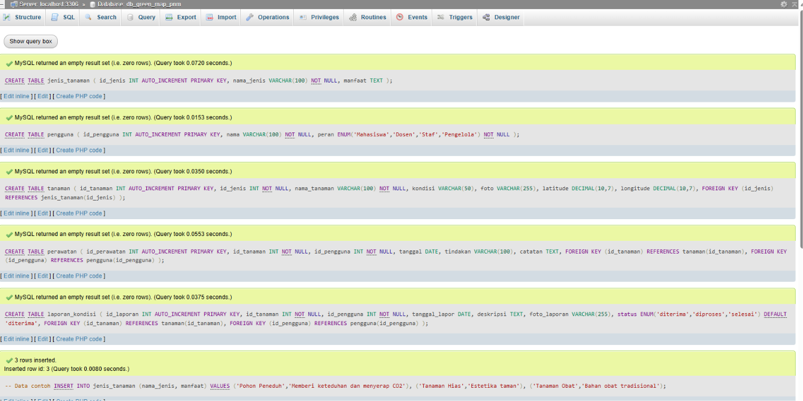
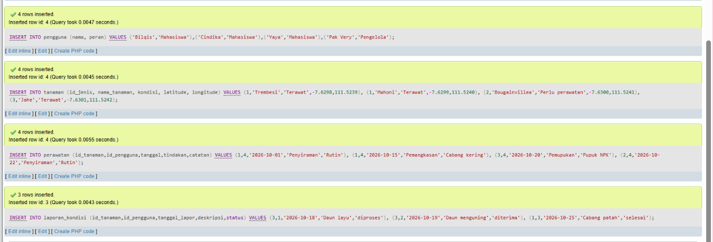
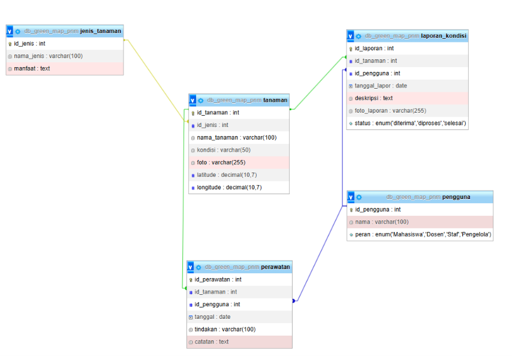
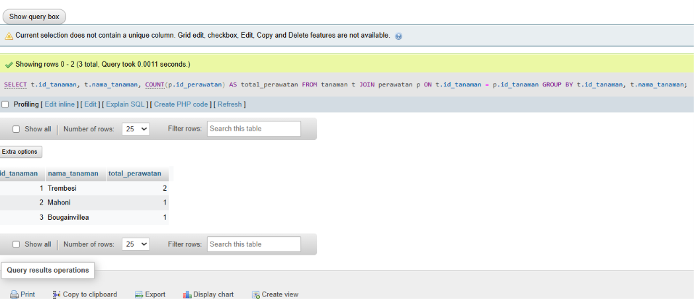
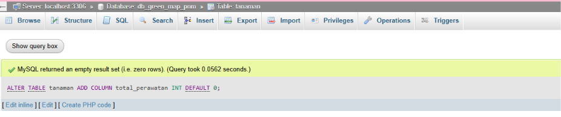
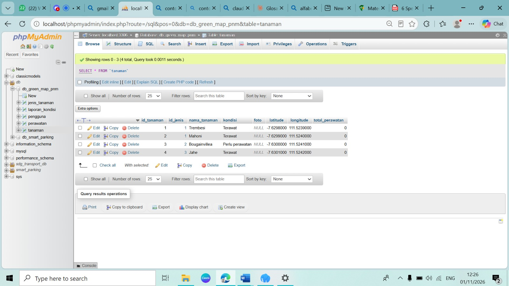
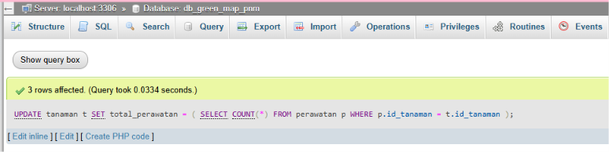
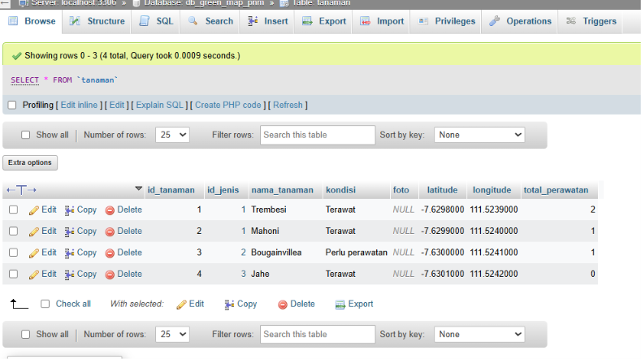
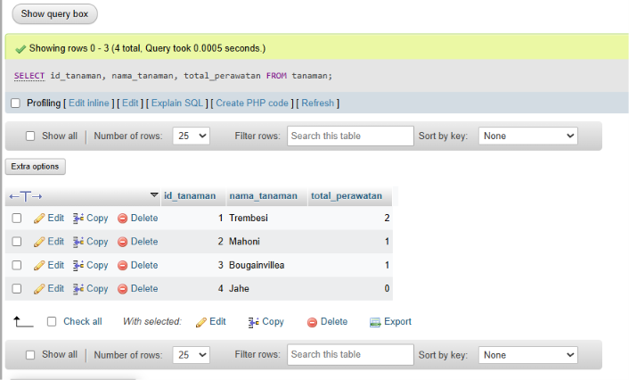

# Green Map PNM - Basis Data

Proyek basis data kelompok untuk Modul 9: Redundansi dan Denormalisasi.

## Anggota Kelompok
| Nama | NIM |
|---|---|
| Bilqis Audynova Prasanty | 264311063 |
| Cindika Zahira Thitania Putri | 264311064 |
| Yaya Winda Salma | 264311087 |

Kelas 1C - Teknologi Rekayasa Perangkat Lunak (TRPL)

## Isi Repository
| File | Keterangan |
|---|---|
| [01_schema_data.sql](sql/01_schema_data.sql) | Pembuatan database, tabel, dan data contoh |
| [02_tahap1_join.sql](sql/02_tahap1_join.sql) | Tahap 1: Query JOIN + COUNT |
| [03_tahap2_denormalisasi.sql](sql/03_tahap2_denormalisasi.sql) | Tahap 2: Denormalisasi (kolom total_perawatan) |
| [04_tahap3_pembuktian.sql](sql/04_tahap3_pembuktian.sql) | Tahap 3: Query tanpa JOIN dan agregasi |

## Urutan Menjalankan
Jalankan file SQL secara berurutan dari 01 sampai 04 di phpMyAdmin.

---

## Bukti Eksekusi

### Database db_green_map_pnm

### Designer (Relasi Antartabel)

### Tahap 1: Query JOIN + COUNT

### Tahap 2: Denormalisasi
**ALTER TABLE**

**UPDATE**

**Cek hasil**

### Tahap 3: Pembuktian

