# Green Map PNM - Basis Data Kelompok 15

Proyek basis data kelompok untuk Modul 9: Redundansi dan Denormalisasi.

## Anggota Kelompok
| Nama | NIM |
|---|---|
| Bilqis Audynova Prasanty | 264311063 |
| Cindika Zahira Thitania Putri | 264311064 |
| Yaya Winda Salma | 264311087 |

Kelas 1C - Teknologi Rekayasa Perangkat Lunak (TRPL)

## Isi Repository
| File | Keterangan |
|---|---|
| [01_schema_data.sql](sql/01_schema_data.sql) | Pembuatan database, tabel, dan data contoh |
| [02_tahap1_join.sql](sql/02_tahap1_join.sql) | Tahap 1: Query JOIN + COUNT |
| [03_tahap2_denormalisasi.sql](sql/03_tahap2_denormalisasi.sql) | Tahap 2: Denormalisasi (kolom total_perawatan) |
| [04_tahap3_query_tanpa_JOIN_dan_agregasi.sql](sql/04_tahap3_query_tanpa_JOIN_dan_agregasi.sql) | Tahap 3: Query tanpa JOIN dan agregasi |
| [05_tahap3_membandingkan_dengan_query.sql](sql/05_tahap3_membandingkan_dengan_query.sql) | Tahap 4: Membandingkan dengan Query |
| [06_posttest_join_kompleks.sql](sql/05_posttest_join_kompleks.sql) | Post-test: Query JOIN kompleks |
| [07_posttest_denormalisasi_dan_query_panggilannya.sql](sql/07_posttest_denormalisasi_dan_query_panggilannya.sql) | Post-test: DDL denormalisasi + query panggilan |

## Urutan Menjalankan
Jalankan file SQL secara berurutan dari 01 sampai 04 di phpMyAdmin.

---

## Bukti Eksekusi

### Database db_green_map_pnm

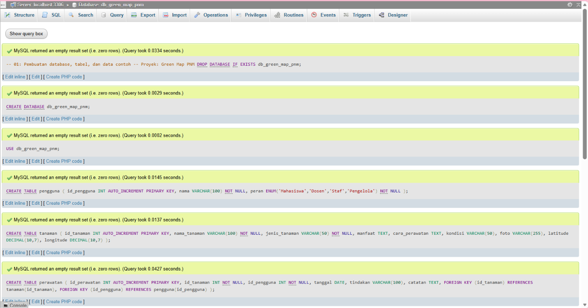

 

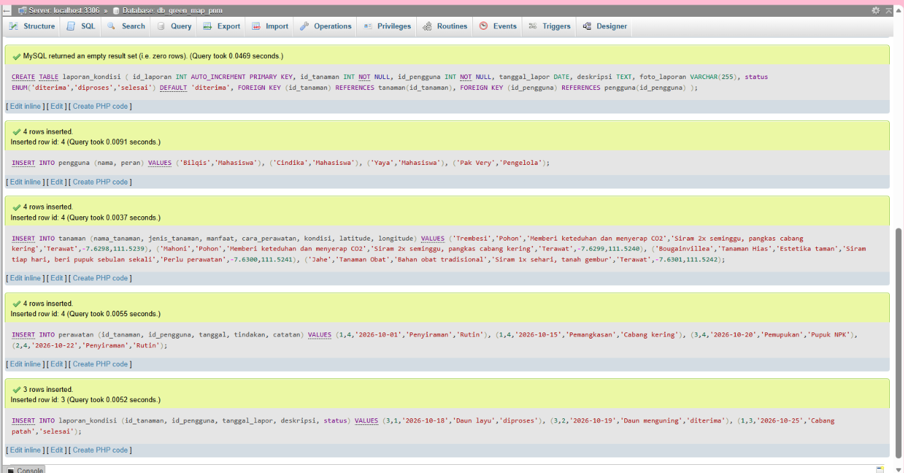

### Designer (Relasi Antartabel)

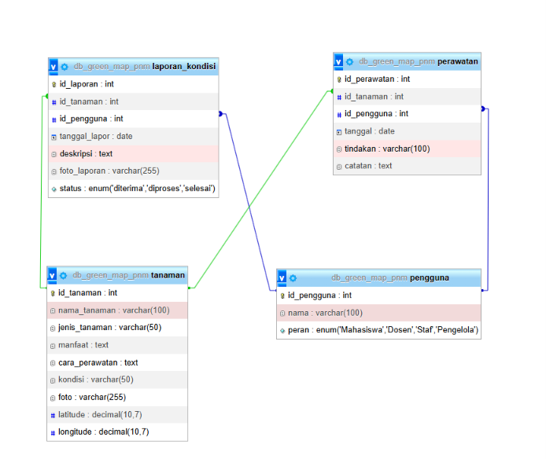

### Tahap 1: Query JOIN + COUNT

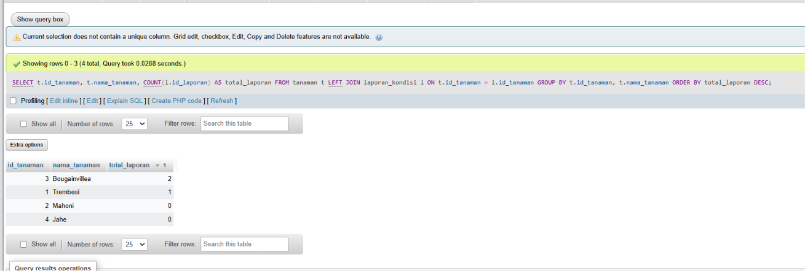

### Tahap 2: Denormalisasi

**ALTER TABLE**

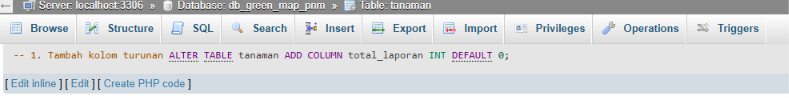

 

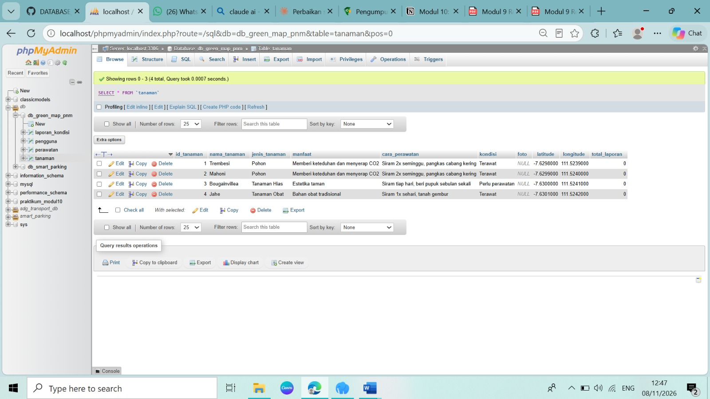

**UPDATE**

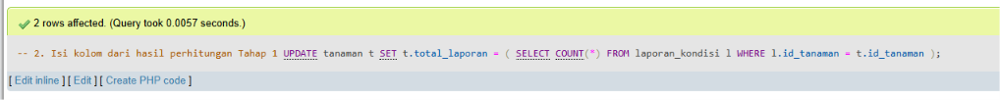

**Cek hasil**

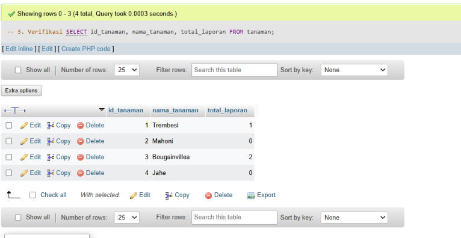

### Tahap 3: Pembuktian

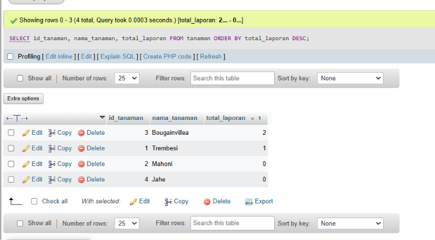

 

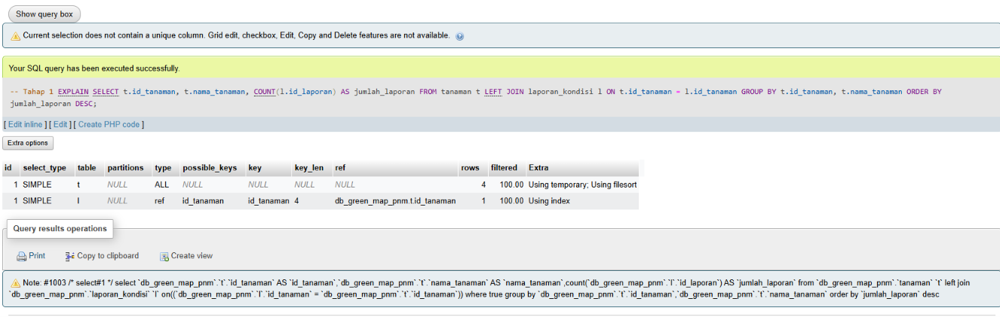

 

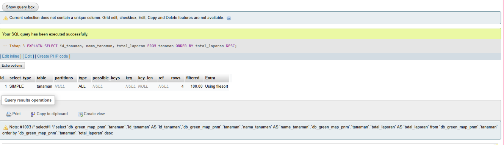

### Post-Test No. 1

**Script 1: Query JOIN kompleks**

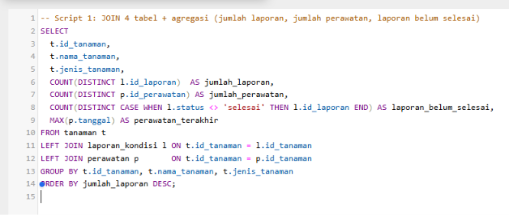

 

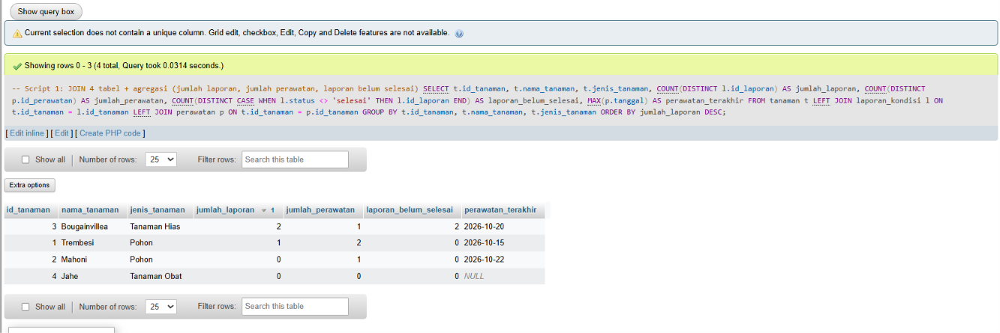

**Script 2: DDL denormalisasi + query panggilan**

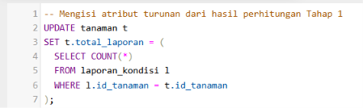

 

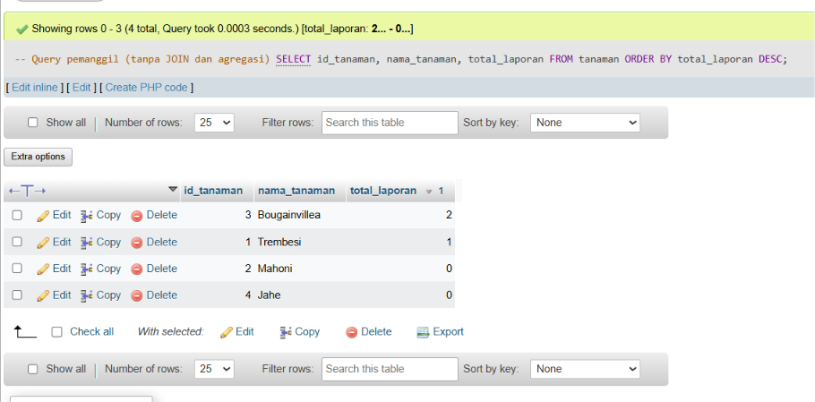
