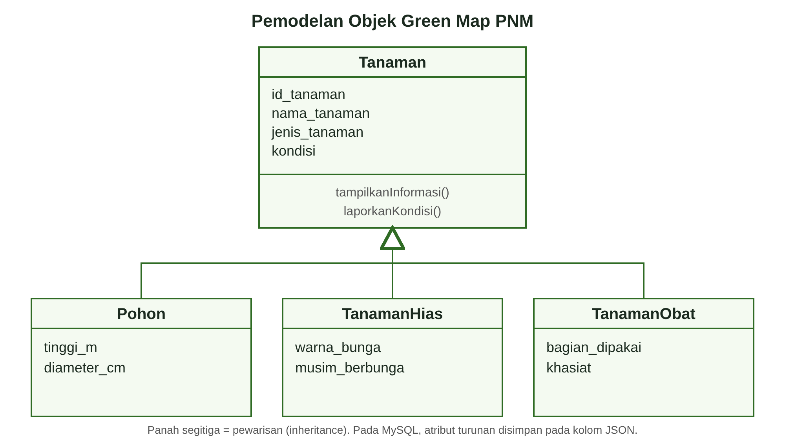

# Praktikum Modul 11 – Eksplorasi DBMS Lanjutan

**Proyek:** Green Map PNM – Sistem Pemetaan dan Identifikasi Tanaman Kampus 2 PNM (SDG 15 Ekosistem Daratan)
**Kelas:** 1C D4 Teknologi Rekayasa Perangkat Lunak (TRPL), Politeknik Negeri Madiun

## Anggota Kelompok

| No | Nama | NIM |
|----|------|-----|
| 1 | Bilqis Audynova Prasanty | 264311063 |
| 2 | Cindika Zahira Thitania Putri | 264311064 |
| 3 | Yaya Winda Salma | 264311087 |

## Struktur Folder

```
praktikum_modul11/
├── sql/
│   ├── 01_database.sql
│   ├── 02_tabel.sql
│   ├── 03_data_awal.sql
│   ├── 04_pengujian_json.sql
│   ├── 05_pemodelan_objek.sql
│   └── 06_implementasi_json_posttest.sql
├── dokumentasi/        (laporan Tahap 1 sampai 5 dan post-test dalam format PDF)
├── diagram/
│   └── pemodelan_objek.png
└── README.md
```

## Isi Script SQL

| File | Database | Keterangan |
|------|----------|------------|
| `01_database.sql` | `praktikum_modul11` | Membuat database praktikum |
| `02_tabel.sql` | `praktikum_modul11` | Membuat tabel `kategori` dan `tanaman` (kolom `atribut` bertipe JSON) |
| `03_data_awal.sql` | `praktikum_modul11` | Mengisi kategori dan tiga tanaman dengan atribut JSON berbeda |
| `04_pengujian_json.sql` | `praktikum_modul11` | Membaca, mengubah, menambah, menghapus, dan mencari atribut JSON |
| `05_pemodelan_objek.sql` | `praktikum_modul11` | Memetakan objek Tanaman ke tabel `tanaman_objek` |
| `06_implementasi_json_posttest.sql` | `db_green_map_pnm` | Script lembar kerja post-test: INSERT, SELECT, UPDATE, dan DELETE atribut JSON pada `tanaman_objek` |

## Cara Menjalankan

DBMS: MySQL/MariaDB (Laragon), antarmuka phpMyAdmin.

1. Nyalakan Laragon, lalu buka phpMyAdmin.
2. Buka tab **SQL** dan jalankan `01` sampai `05` berurutan. Pastikan database `praktikum_modul11` terpilih sebelum menjalankan `02` sampai `05`.
3. `06_implementasi_json_posttest.sql` dijalankan pada database `db_green_map_pnm`. Script ini mensyaratkan tabel `kategori_tanaman` dan `tanaman_objek` sudah ada (struktur pada laporan post-test bagian 2.1).

## Dokumentasi

Seluruh laporan Modul 11 (Tahap 1 sampai 5 dan post-test) tersedia dalam format PDF di folder [`dokumentasi`](dokumentasi).

## Diagram



Diagram kelas objek Tanaman dengan turunan Pohon, TanamanHias, dan TanamanObat.
